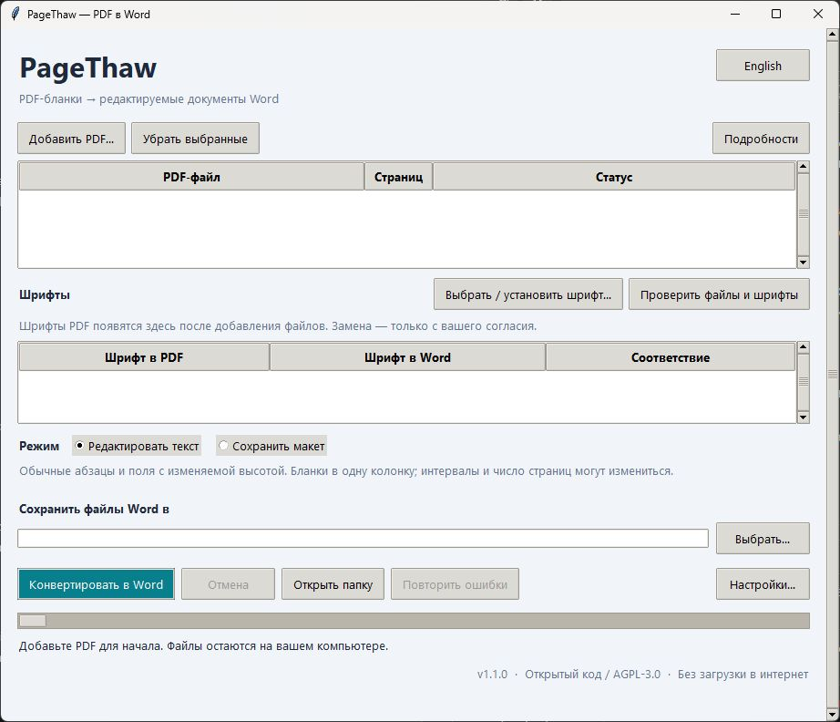

# PageThaw

### PDF-бланки → редактируемые документы Word

Выбирайте обычное редактирование или сохранение макета. Конвертируйте без интернета.

[English](README.md) · **Русский**

**[Скачать для Windows](https://github.com/DelureDev/pagethaw/releases/latest)** · [Сообщить о проблеме](https://github.com/DelureDev/pagethaw/issues)

Windows 10/11 x64 · Бесплатно, с открытым кодом · English / Русский

---

## Начните за 4 шага

1. **Скачайте и откройте** `PageThaw-…-windows-x64.exe` из последнего релиза.
   Один файл, без установки и распаковки.
2. **Добавьте PDF.** Приложение автоматически проверит файлы и шрифты.
3. **Выберите шрифт, если нужно.** Добавьте свой `.ttf` / `.otf` или
   подтвердите замену на установленный. Без вашего выбора замены не будет.
4. **Выберите режим и папку результата**, затем нажмите **Конвертировать в Word**.
   Откройте файлы `.docx` в настольном Word и проверьте каждую страницу.

В выбранной папке будут **только файлы Word**. Можно конвертировать в неё повторно:
старые файлы сохранятся, новые получат имена вроде `бланк (2).docx`.
Раздел **Шрифты** всегда виден. Если точный шрифт не найден или совпадение
не подтверждено, появится предупреждение. Нажмите **Выбрать / установить шрифт…**.
Дополнительные параметры — в разделе **Настройки…**.

Папка результата и подтверждённые шрифты запоминаются и проверяются при следующем
запуске. Если файл не сконвертирован, откройте **Подробности**, устраните причину
и нажмите **Повторить ошибки**. Готовые документы повторно не конвертируются.

**Для конвертации не нужны аккаунт, Python или установленный Word.** Всё происходит
на вашем компьютере. Язык интерфейса меняется кнопкой **Русский / English** справа
вверху. Выбор сохраняется между запусками.

## Возможности

**Редактировать текст** — обычные абзацы и ячейки таблиц вместо прочерков.
Введите текст в пустую ячейку: длинная запись увеличит её высоту и сдвинет текст ниже.
Режим подходит для простых бланков в одну колонку. Интервалы и число страниц могут измениться.

**Сохранить макет** — исходное расположение с помощью текстовых блоков. Подходит,
когда важнее внешний вид, чем большие правки. Приложение не переключает режим само.

| Возможность | Что она даёт |
| :--- | :--- |
| Пакетная конвертация | Несколько PDF за один запуск; результат виден в приложении. |
| Два режима | Обычные абзацы для редактирования или текстовые блоки для сохранения макета. |
| Выбор шрифтов | Обычное, полужирное и курсивное начертания; замена только с подтверждением. |
| Прочерки в бланках | Можно превратить подчёркивания в сплошные линии. |
| Сравнение страниц | При установленном Word — изображения исходных и полученных страниц рядом. |

Посмотреть интерфейс на русском

Нужна версия в папке? В релизе также есть облегчённый ZIP. Распакуйте его целиком
и оставьте папку `_internal` рядом с `PageThaw.exe`.

## Перед конвертацией

> **Лучше всего подходит для цифровых бланков с выделяемым текстом.**
> Сканы сначала нужно распознать (OCR). Результат не всегда совпадает с PDF до пикселя — проверяйте страницы.

- Режим редактирования отклоняет неоднозначные колонки, сложные таблицы и пересечения
  графики с текстом. Сноски и нумерация сохраняются как текст, а не специальные функции Word.
- В режиме сохранения макета блоки **не перетекают**. Длинные правки могут потребовать ручной корректировки.
- Другой шрифт может изменить интервалы. Шрифты не входят в приложение и не
  встраиваются в DOCX; на другом компьютере их тоже нужно установить.
- Повёрнутый текст, разные размеры страниц и интерактивные поля PDF пока не поддерживаются.
- Приложение без цифровой подписи. Если Windows блокирует запуск, следуйте правилам
  вашей организации. Контрольные суммы есть в каждом релизе.

## Подробнее

[Подробное руководство и командная строка (EN)](docs/USAGE.md) · [Проведённые проверки (EN)](docs/VERIFICATION.md) · [Участие в разработке (EN)](CONTRIBUTING.md)

Лицензия: [GNU AGPL v3.0](LICENSE). Используются [PyMuPDF и другие открытые компоненты](THIRD_PARTY.md).
Приложение не отправляет файлы в интернет и не собирает телеметрию. Личные документы и пользовательские шрифты не публикуются.
