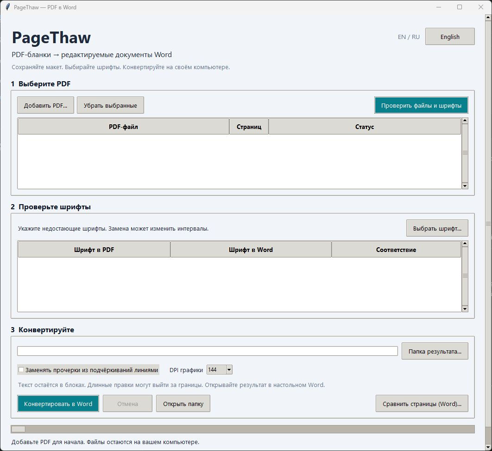

# PageThaw

### PDF-бланки → редактируемые документы Word

Сохраняйте макет. Выбирайте шрифты. Конвертируйте без интернета.

[English](README.md) · **Русский**

**[Скачать для Windows](https://github.com/DelureDev/pagethaw/releases/latest)** · [Сообщить о проблеме](https://github.com/DelureDev/pagethaw/issues)

Windows 10/11 x64 · Бесплатно, с открытым кодом · English / Русский

---

## Начните за 4 шага

1. **Скачайте и распакуйте** `PageThaw-…-windows-x64.zip` из последнего релиза.
   Извлеките всю папку и откройте **PageThaw.exe**. Папка `_internal` должна оставаться рядом.
2. **Добавьте PDF** и нажмите **Проверить файлы и шрифты**.
3. **Проверьте шрифты.** Если шрифт отсутствует, добавьте свой `.ttf` / `.otf` или
   подтвердите замену на установленный. Без вашего выбора замены не будет.
4. **Выберите новую папку результата** и нажмите **Конвертировать в Word**.
   Откройте файлы `.docx` в настольном Word и проверьте каждую страницу.

**Для конвертации не нужны аккаунт, Python или установленный Word.** Всё происходит
на вашем компьютере. Язык интерфейса меняется кнопкой **Русский / English** справа
вверху. Выбор сохраняется между запусками.

## Возможности

| Возможность | Что она даёт |
| :--- | :--- |
| Пакетная конвертация | Несколько PDF за один запуск, с отчётом по каждому файлу. |
| Редактируемый макет | Текст остаётся в блоках, логотипы и рамки — на своих местах. |
| Выбор шрифтов | Обычное, полужирное и курсивное начертания; замена только с подтверждением. |
| Прочерки в бланках | Можно превратить подчёркивания в сплошные линии. |
| Сравнение страниц | При установленном Word — изображения исходных и полученных страниц рядом. |

Посмотреть интерфейс на русском

## Перед конвертацией

> **Лучше всего подходит для цифровых бланков с выделяемым текстом.**
> Сканы сначала нужно распознать (OCR). Результат не всегда совпадает с PDF до пикселя — проверяйте страницы.

- Текстовые блоки сохраняют положение, но **не перетекают**, как обычные абзацы.
  Длинные правки могут потребовать ручной корректировки.
- Другой шрифт может изменить интервалы. Шрифты не входят в приложение и не
  встраиваются в DOCX; на другом компьютере их тоже нужно установить.
- Повёрнутый текст, разные размеры страниц и интерактивные поля PDF пока не поддерживаются.
- Приложение без цифровой подписи. Если Windows блокирует запуск, следуйте правилам
  вашей организации. Контрольные суммы есть в каждом релизе.

## Подробнее

[Подробное руководство и командная строка (EN)](docs/USAGE.md) · [Проведённые проверки (EN)](docs/VERIFICATION.md) · [Участие в разработке (EN)](CONTRIBUTING.md)

Лицензия: [GNU AGPL v3.0](LICENSE). Используются [PyMuPDF и другие открытые компоненты](THIRD_PARTY.md).
Приложение не отправляет файлы в интернет и не собирает телеметрию. Личные документы и пользовательские шрифты не публикуются.
